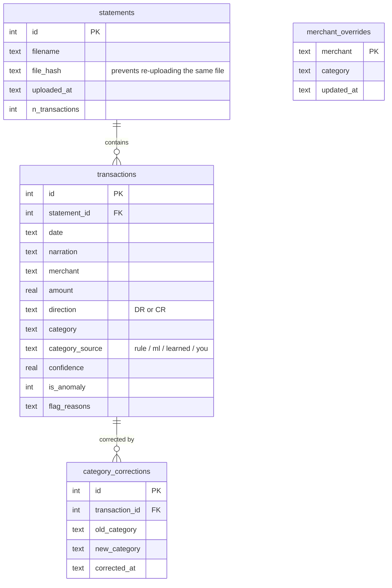

# Where did my money go? A UPI / bank statement analyser

Messy bank statement CSV -> parsed -> auto-categorised (rules + ML) -> anomaly flags -> stored in **SQLite** -> monthly Budget Health Score -> dashboard.

## Run it
```bash
pip install -r requirements.txt
python generate_synthetic.py      # makes data/sample_statement.csv (synthetic, safe to share)
python -m src.pipeline            # trains the model, creates data/finance.db, seeds it, writes outputs/*.csv for Power BI
streamlit run app.py              # dashboard; upload your own statement in the sidebar
```
Your real statement: upload it in the app. It's parsed in memory, then saved to **`data/finance.db`** on your own machine only - nothing leaves your computer. Never commit that file (`.gitignore` covers `data/*.db` and `data/real_*`).

## Why a database, not just CSVs
A CSV forgets everything the moment the app closes. A database means:
- **Every statement you've ever uploaded stays available** - switch between "latest upload" and "all statements combined" in the sidebar, so you can track spending across months without re-uploading each time.
- **Corrections you make are permanent.** Fix "MTR RESTAURANT" from Uncategorized to Food once, in the *Review & fix* tab, and it's applied to every past occurrence of that merchant immediately, and to every future statement automatically (`merchant_overrides` table) - the review queue gets shorter over time instead of repeating itself.
- **It's real SQL you can inspect or query**, either with the in-app *SQL explorer* tab or directly: `sqlite3 data/finance.db "select category, sum(amount) from transactions group by 1;"`

See `schema.sql` for the full table definitions, or the diagram below.



## What is inside
| Step | File | What it does |
|---|---|---|
| Generate | `generate_synthetic.py` | 12 months of realistic messy UPI/NEFT rows, 6 narration formats, hidden ground truth |
| Parse | `src/parse.py` | Detects columns, fixes dates and amounts, strips bank noise from narrations, extracts merchant |
| Categorise | `src/categorize.py` | Learned overrides first, then rules for known merchants, then TF-IDF char n-grams + Logistic Regression, low-confidence rows go to a review queue |
| Flag | `src/anomaly.py` | Robust z-score per category, duplicate charges, big first-time payees, each with a reason |
| Score | `src/score.py` | 0-100 monthly health score (savings 35, needs 25, wants 20, stability 10, anomalies 10) |
| Store | `src/db.py`, `schema.sql` | SQLite: transactions, statements, learned merchant rules, correction history |
| Glue | `src/pipeline.py` | `ingest()` ties parsing -> categorising -> flagging -> database together, skips duplicate files |
| Show | `app.py`, `powerbi/` | Streamlit dashboard (reads/writes the database), Power BI build guide with DAX |

## Results (synthetic data, held-out labels)
Run `python -m src.pipeline` to reproduce. Typical output:
- Seen merchants: macro F1 about 0.99
- **Brand-new merchants**: ML alone about 0.42 F1, rules + ML about 0.72 F1, 73% auto-labelled at 87% accuracy, the rest goes to review
- Anomalies: caught 11 of 12 injected oddities (about 92% recall)
- After a handful of corrections in the *Review & fix* tab, the review queue for those merchants drops to zero permanently

## Honest limitations
- Synthetic data is cleaner than a real statement. Expect lower accuracy on your own.
- Statements only have dates, not times, so "unusual hour" checks aren't possible.
- Person-to-person payments (names) can't be categorised by text; the model uses amount patterns.
- Health-score thresholds are a sensible default, not financial advice.
- SQLite is single-file and fine for one person's use; it isn't built for many people writing to it at once.

## Ideas to extend
Retrain the ML model itself from `category_corrections` (not just the merchant-override table), forecast next month's spend, a `users` table if this ever serves more than one person, multi-account merge.
